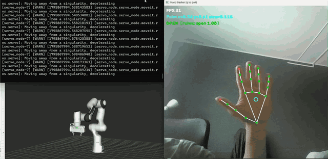

# hand-teleop

Control a simulated Panda arm (ROS 2 Jazzy + MoveIt Servo) by moving your hand in front of a webcam. Pinch to close the gripper, make a fist to clutch, thumbs up to recenter. The gestures come from a rule-based classifier, or from a small MLP trained on your own recordings.



The gestures in action (open, pinch, fist clutch, thumbs up): [docs/demo.mp4](docs/demo.mp4)

I built this during my Erasmus in Skövde, mostly as an excuse to learn MoveIt Servo properly. The plan is to move it to a real arm next.

## How it works

```
webcam
  |
hand_tracker.py      (Windows, MediaPipe Hand Landmarker + gesture MLP)
  |  UDP, JSON per frame
udp_bridge           (WSL, ROS 2)   -> /hand/target, /hand/gripper_closed, /hand/gesture, /hand/clutch, /hand/marker
  |
hand_to_servo                       -> /servo_node/pose_target_cmds + gripper action
  |
MoveIt Servo -> panda_arm_controller / panda_hand_controller (ros2_control, mock hardware)
```

The tracker runs on Windows and ROS runs in WSL2, because getting a webcam into WSL is a pain and MediaPipe works fine on Windows anyway. They talk over plain UDP, one small JSON packet per frame.

For depth I use the apparent size of the hand (wrist to middle knuckle, in pixels). MediaPipe's z is relative to the wrist, so it doesn't tell you how far the hand is from the camera, but the hand does look bigger when it gets closer. Image x/y and that size get mapped linearly into a box in front of the robot, then smoothed with an EMA filter because the raw landmarks jitter a bit.

## Gestures

| Gesture   | What it does |
|-----------|--------------|
| open hand | arm follows the hand, gripper open |
| pinch     | arm follows the hand, gripper closed |
| fist      | clutch: the arm stays where it is while you move your hand |
| thumbs up | recenter: the arm goes back to following the absolute hand position |

The clutch is the same idea as on surgical robots. When you run out of camera, make a fist, move your hand back to the middle, open it, and the arm carries on from where it stopped instead of jumping. Losing the hand works the same way, so the arm doesn't jump when the hand comes back either. The gripper keeps its state during a clutch, so you can carry something while repositioning.

The classifier is an MLP (63 inputs, 64 and 32 hidden units, about 6k parameters) on the 21 landmarks, translated to the wrist and scaled by the hand size so position and distance to the camera don't matter. Left hands are mirrored. A prediction only counts after 4 frames in a row with confidence above 0.7, otherwise one bad frame drops whatever you're holding. There's also a rule-based classifier (finger extended or not) that's used when there is no trained model, and `train_gestures.py` scores both on the same test frames.

Inference is done in plain numpy from a JSON file with the weights, not with scikit-learn, so the model is easy to port to C later.

To record your own data and train:

```powershell
.venv\Scripts\python.exe collect_gestures.py   # 0-4 to record a gesture, space to stop, q to quit
.venv\Scripts\python.exe train_gestures.py     # writes models/gesture_mlp.json
```

A few hundred frames per gesture is enough. Move the hand around while recording, and record some random hand poses as "other" (key 0) so it doesn't force everything into one of the four classes.

The gripper only gets a new goal when the pinch state changes, not every frame. Servo is limited to 0.25 m/s, and the bridge stops publishing when it loses the hand, so after 0.2 s without commands Servo stops the arm.

## Running it

You need Windows with WSL2 (Ubuntu 24.04), ROS 2 Jazzy installed in WSL, and Python 3.12 on Windows.

On Windows:

```powershell
py -3.12 -m venv .venv
.venv\Scripts\python.exe -m pip install -r requirements.txt
```

In WSL, install MoveIt Servo, the Panda config and ros2_control, then build:

```bash
sudo apt install ros-jazzy-moveit ros-jazzy-moveit-servo \
  ros-jazzy-moveit-resources-panda-moveit-config ros-jazzy-moveit-resources-panda-description \
  ros-jazzy-ros2-control ros-jazzy-ros2-controllers

mkdir -p ~/ros2_ws/src
ln -s /mnt/c/path/to/hand-teleop/ros2/hand_teleop_bridge ~/ros2_ws/src/
ln -s /mnt/c/path/to/hand-teleop/ros2/hand_teleop_servo ~/ros2_ws/src/
cd ~/ros2_ws && source /opt/ros/jazzy/setup.bash
colcon build --symlink-install
```

Then start the robot side in WSL:

```bash
source ~/ros2_ws/install/setup.bash
ros2 launch hand_teleop_servo hand_teleop.launch.py
```

and the tracker on Windows:

```powershell
.venv\Scripts\python.exe hand_tracker.py
```

It finds the WSL IP by itself (`--host` to override, `--no-send` to only see the camera). The MediaPipe model gets downloaded the first time. Press q to quit.

## Results

Measured on my laptop, so take them as rough numbers:

- Sending three fixed hand positions over UDP, panda_link8 ended up less than 1 mm from each target, with the orientation unchanged and the gripper opening and closing correctly.
- Tracker: between 19 and 32 FPS at 1280x720 depending on the run. My first measurement gave 19 (MediaPipe taking around 49 ms per frame on the CPU), the demo recording shows around 31. Either way MediaPipe is the main bottleneck.
- UDP packet to /hand/target: median 32 ms (22 to 52 ms over 20 tries), measured inside WSL. The Windows to WSL hop itself is under 1 ms (0.4 ms round trip).

Tests: `.venv\Scripts\python.exe -m pytest tests` for the gestures (on synthetic hands, plus a full training run), and `cd ros2/hand_teleop_bridge && python3 -m pytest test` in WSL for the mapping, clutch and gesture actions.

## Known issues / next

- Depth from hand size depends on the person. size_far/size_near are tuned to my hand, it really needs a quick calibration step.
- Orientation is fixed with the gripper pointing down. Getting the wrist rotation from the hand is the obvious next thing.
- On startup there are a couple of harmless warnings: a TF lookup of "world" before the static transform is up, and a deprecation warning for the gripper controller type that comes from the moveit_resources config.
- The gesture model is trained on my hand and my lighting. The test split is random frames from the same sessions, so the accuracy is optimistic; recording on a different day is a fairer test.
- Next: drive a real arm with an ESP32-S3 running micro-ROS. The ROS side already only talks in terms of /hand/target, /hand/gripper_closed and /hand/clutch, so the hardware just has to subscribe to those (or to the joint commands coming out of Servo).
